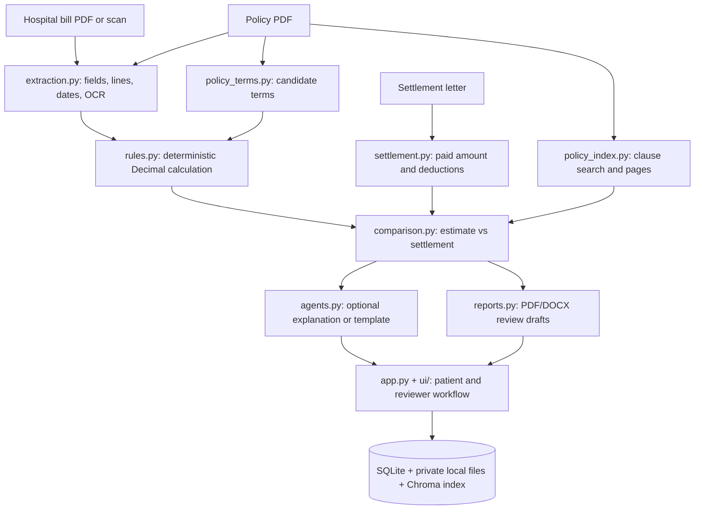

# MediGuard AI — final prototype status

**Branch:** `fix/prototype-completion`  
**Scope:** college demonstration prototype; fictional/de-identified documents only. Deployment is excluded.  
**Last verified:** 2026-10-19; `198 passed` in the full Python test suite.

## What it does

MediGuard AI reads a fictional hospital bill, policy and insurer settlement letter. It extracts dates, totals and line items, prepares policy term candidates and clause evidence, calculates a policy-based estimate with deterministic Python rules, then compares that estimate with the settlement. It can explain the result and draft an appeal, but an authorized reviewer must confirm policy terms and all final decisions. It is not an insurer decision system.

## How it is built

A more detailed architecture image is [docs/architecture.svg](C:/MediGaurd%20AI/docs/architecture.svg).

## Verification results

- **Math:** 17 hand-calculated rules cases and 2 comparison cases are documented in `docs/GOLDEN_CASES.md`. Direct tests cover deductible, co-pay, room/ICU caps, exclusions, sub-limits, annual limit, zero/boundary amounts and date windows. All passed; no expected arithmetic was changed to accommodate the implementation.
- **Automated tests:** `198 passed in 29.81s` with Ollama explicitly disabled.
- **Extraction evaluation:** `12/12` field values matched (`100%`) across three fictional bills. This is a small fixture check, not a real-world accuracy estimate.
- **End-to-end status evaluation:** `12/24` expected labels matched (`50%`). Every run stopped at the human policy-term confirmation gate, so this number measures app-level status agreement on the current harness, not claim-math accuracy. The standalone rule score remains unmeasured until the evaluation harness supplies reviewer-confirmed terms.
- **Retrieval:** one labeled synthetic query; precision@1 `1.00`, precision@3 `0.33`, precision@5 `0.20`, recall@3/5 `1.00`. One query is too small to support a general quality claim.
- **LLM safety:** automated tests cover fabricated numbers, down/timeout/malformed responses, and prove a valid explanation cannot mutate a comparison. Invalid/unavailable output falls back to a template. The validator checks every number against comparison values or cited clause identifiers. A live Ollama ON-vs-OFF run of all three demo cases was not completed, so live model equivalence remains unverified.
- **Browser:** Playwright captured welcome, sign-in, dashboard, registration, upload and claim-result screenshots. A match-case bill reached a safe manual-review screen because the reviewer had not confirmed terms; the test registration also used a different claim ID from its settlement fixture, correctly causing an ID-mismatch review. The three complete UI scenarios and all five requested upload-error cases were not fully exercised in the browser. Upload validation and three case outcomes are covered by automated Python tests.

## Limits and next actions

The sample is fictional and small. Policy interpretation, OCR, retrieval relevance and generated draft quality are not validated by independent insurance experts. The UI requires a reviewer to confirm policy terms; the current evaluation runner does not automate this step. The browser matrix and live Ollama comparison remain incomplete. Docker/hosting was excluded as requested. Do not use real patient documents or treat estimates as final decisions.

## Run it

1. From the repository root, create `.env` from `.env.example` and set a strong `MEDIGUARD_ADMIN_PASSWORD` only if an administrator login is needed.
2. Activate `.venv`, then run `python -m streamlit run app.py` and open `http://127.0.0.1:8501`. For isolated synthetic demo storage, run `python run_demo.py` at port `8506`.
3. Use only documents under `fixtures/demo_cases/`. A reviewer must confirm policy values and source pages before financial results are shown.
4. Verify code with `python -m pytest -q`. See `docs/DEMO_GUIDE.md` for fixture paths and expected outcomes.
