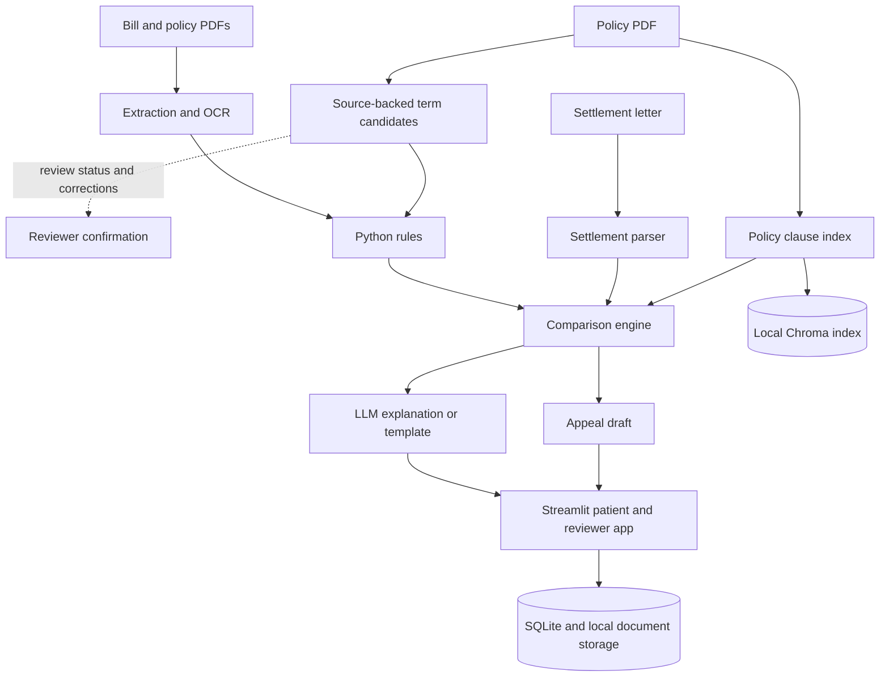

# MediGuard AI

## What it is

MediGuard AI is a college prototype that reads a hospital bill, insurance policy, and settlement letter.
Python calculates a provisional policy estimate and compares it with the insurer's settlement before a reviewer confirms the policy terms.
It is for fictional examples only; provisional estimates are never final insurer decisions.

## The key rule

**Python decides; the LLM only explains.** Deterministic Python rules set amounts, status, and appeal eligibility. A local LLM can explain a completed result, but cannot change it. Invalid or unavailable model responses use a checked template.

## Architecture



The [architecture guide](docs/02_ARCHITECTURE.md) describes each step and local service.

## Folder map

```text
app.py                         Thin Streamlit entry point
run_demo.py                    Fictional demo launcher
.env.example                   Local settings template
requirements.txt               Pinned app dependencies
.gitignore                     Local files excluded from Git
Dockerfile                     Kept for later; not part of this verification
mediguard/                     Application modules grouped by responsibility
  ingestion/ policy/ engine/ ai/ reporting/ services/ ui/
config/                        Categories and trusted fictional fixture hashes
samples/                       Fictional demo cases, policies, bills, and test documents
tests/                         Unit, integration, and golden checks
evaluation/                     Labels, evaluation scripts, and latest scores
  scripts/ latest/
docs/                           Numbered guides and archived project records
.github/                       Automated test workflow
```

The small `.streamlit/config.toml` file sets the app theme and local server defaults. `.dockerignore` keeps secrets and local data out of any future image build; `.gitattributes` keeps text line endings predictable. Docker/hosting are outside the current scope.

## Requirements

- Windows 10/11 and Python 3.13 for the verified setup.
- Tesseract OCR installed locally for scanned document pages. The example configuration points to the common Windows installer location; change `TESSERACT_CMD` in `.env` if yours differs.
- Ollama is optional. It is used only for explanations. The checked model is `ibm/granite4.1:8b`; the deterministic rules work with Ollama off.
- The configured BGE-small embedding model is downloaded locally the first time the clause index is used. Allow internet access for this first download, or prepare the model cache separately.

## Setup on Windows PowerShell

Run these commands from the repository root:

```powershell
py -3.13 -m venv .venv
.\.venv\Scripts\python.exe -m pip install --upgrade pip
.\.venv\Scripts\python.exe -m pip install -r requirements.txt -r tests/requirements-dev.txt
Copy-Item .env.example .env
```

Install Tesseract separately if scanned-page OCR is needed, then update `TESSERACT_CMD` in `.env` to its executable path. Keep `.env` local; never commit it. `MEDIGUARD_CORE_DEMO` remains `false` for the regular app.

## Run the app and demo

Run the regular app on port 8501:

```powershell
.\.venv\Scripts\python.exe -m streamlit run app.py --server.port 8501
```

Open [http://127.0.0.1:8501](http://127.0.0.1:8501). Claimants can register, upload documents, and see a provisional result. A reviewer can confirm or correct policy terms later; linked claims recompute, and the claimant sees the updated badge after refresh. Reviewer access uses the app's invitation flow.

For the isolated fictional demo, create a local reviewer password in the current PowerShell session and launch the demo:

```powershell
$env:MEDIGUARD_ADMIN_PASSWORD = Read-Host "Choose a local demo password"
.\.venv\Scripts\python.exe run_demo.py
```

Open [http://127.0.0.1:8506](http://127.0.0.1:8506) and sign in as `demo@mediguard.local` with the password set above. Demo records are stored under ignored `data/final_demo/`. Stop either app with Ctrl+C.

## The three demo cases

All files are under `samples/demo_cases/` and carry a `FICTIONAL SAMPLE` label.

- `a_match`: expected `no_discrepancy`; the provisional estimate matches the settlement; no appeal draft.
- `b_wrongful_deduction`: expected `possible_discrepancy`; supported INR 2,700 patient-share difference; a watermarked provisional appeal draft is available before confirmation.
- `c_manual_review`: expected `manual_review` because the bill includes a scanned page and the settlement total does not reconcile; a specific reason is shown and no appeal draft is available.

See [03_RUNNING_THE_DEMO.md](docs/03_RUNNING_THE_DEMO.md) for the reviewer steps and detail.

## Run tests and evaluations

Create the environment as described above. The tests and offline evaluation run without Ollama or a browser. They use only fictional, hand-labeled samples.

```powershell
$env:OLLAMA_HOST = 'http://127.0.0.1:1'
$env:MEDIGUARD_EVAL_LIVE = 'false'
$env:MEDIGUARD_EVAL_BROWSER = 'false'
$testTemp = Join-Path $env:TEMP ("mediguard-pytest-" + [guid]::NewGuid().ToString("N"))
.\.venv\Scripts\python.exe -m pytest -q tests --basetemp $testTemp
.\.venv\Scripts\python.exe -m evaluation.run_all
```

To run the optional live checks, install Chromium once with `.\.venv\Scripts\python.exe -m playwright install chromium`, start Ollama with `ibm/granite4.1:8b` available, then set `MEDIGUARD_EVAL_LIVE=true` and `MEDIGUARD_EVAL_BROWSER=true` before `python -m evaluation.run_all`. The browser suite starts an isolated local app and saves screenshots in the system temporary folder, outside the repository.

The 30 case labels are in `samples/evaluation_cases/ground_truth.json`; their PDFs and reviewer-confirmed terms are in `samples/evaluation_cases/cases/`. The labeled retrieval set is `evaluation/retrieval_queries.json`. The command writes machine-readable results to `evaluation/latest/results.json` and the scorecard and case table to `docs/06_EVALUATION_RESULTS.md`.

## Verified results

Latest recorded evaluation scores are validated on **30 synthetic cases**, with an additional **3 app-path demo cases**; these are not general accuracy claims. The hand-labeled expected results were committed before scoring.

- Automated suite: **230 passed** with Ollama disabled (use the fresh temporary pytest base command above).
- Result shown without reviewer confirmation: **3/3 demo cases** reached an app-path result; provisional status, insurer estimate, and comparison difference matched the later reviewer-confirmed run on all three.
- Extraction totals: **30/30 (100%)**; other labeled fields: **60/60 (100%)**.
- Text-bill line items: precision **28/28 (100%)**, recall **28/28 (100%)**; OCR field accuracy **6/6 (100%)**.
- Reviewer-confirmed policy terms: **90/90 (100%)**.
- Rules golden agreement: **24/24 (100%)**; property checks: **211/211 (100%)**.
- Adversarial parser set: **10/10 cases**, **61/61 labeled field checks**, line-item precision/recall **1.00/1.00**. Labels were committed before scoring.
- Comparison labels: **30/30 (100%)**; discrepancy false matches: **0/10**. Settlement paid-amount F1: **100% (28 labeled payments)**; deduction F1: **100% (37 labeled deductions)**.
- Retrieval over 30 questions: P@1 **30/30 (100%)**, P@3 **30/90 (33.3%)**, P@5 **30/150 (20%)**, recall@5 **30/30 (100%)**, MRR **1.000**. The latest evaluation used Chroma's default fallback embedding backend because the configured BGE model was unavailable. These are synthetic query scores, not a claim of broad policy-search accuracy.
- Ollama ON/OFF decision equality: earlier recorded checks were **3/3 demo cases** in the system evaluation and **10/10 discrepancy cases** in the explanation/performance run; explanation checklist **30/30** across ten live model texts. These were not rerun during the provisional-flow change. The Playwright run was attempted but is **not passing**: the existing reviewer-workspace script returned **0/8** and remained on its initial review tab after the rules step. I have not isolated whether this is tab state in the app or outdated automation; claimant-first browser acceptance and the five upload errors remain unverified. Screenshots are outside the repository.
- Mean offline evaluation-run time: **0.602 seconds per case** for the latest 30-case run. The focused end-to-end claim timing above includes the explanation path and is reported separately.
- Focused ten-claim timing: **0.632 s/claim** with Ollama off and **35.716 s/claim** with it on; on-mode Ollama/llama-server RSS peaked at **5,259.4 MiB**. Full method and warm-model details are in `docs/06_EVALUATION_RESULTS.md`.

The CI workflow runs the offline tests and evaluation. Ollama and browser checks are optional local checks and are reported separately. The earlier **13/24** was rules-only status agreement with reviewer-confirmed policy terms supplied; **12/24** was the full-app result with reviewer gates included. They are distinct measurements from an older set, not one comparable overall accuracy figure; see `docs/06_EVALUATION_RESULTS.md` for the full explanation.
## Limitations

Policy wording and OCR can be ambiguous, retrieval precision at 3/5 is low, and the reported scores apply only to small fictional labeled sets. Reviewers must inspect the cited policy page and all outputs. A broad clause exclusion filter can drop a coverage sentence when another sentence in the same passage contains exclusion wording. Appeal documents are drafts, not legal advice. Security, privacy, expert accuracy, and production performance have not been independently assessed. Hosting is not tested.

## Disclaimer

Use fictional data only. MediGuard AI is a college demonstration prototype, not an insurer decision system, legal service, or substitute for a qualified human review. Do not upload real patient records or use its output to make a claim decision.
