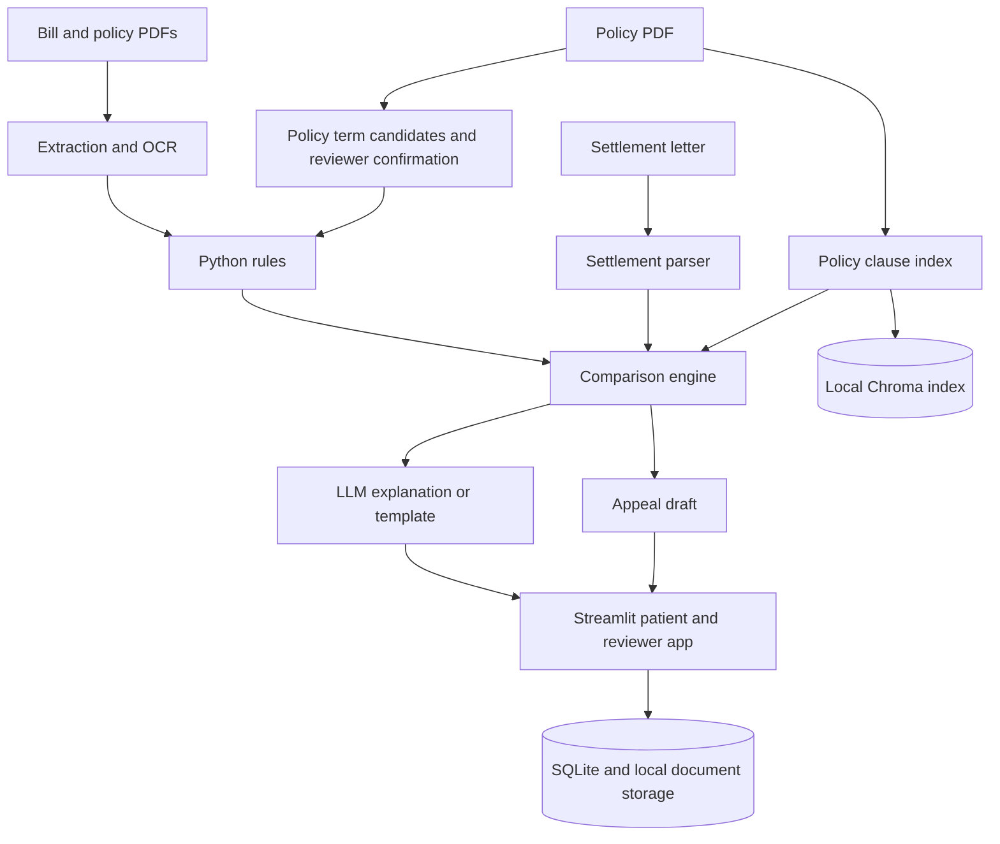

# MediGuard AI

## What it is

MediGuard AI is a college prototype for reading a hospital bill, insurance policy, and settlement letter.
It calculates a policy-based estimate and compares it with the insurer's settlement.
A reviewer checks policy evidence before the result is shown; all included documents are fictional.

## The key rule

**Python decides; the LLM only explains.** Deterministic Python rules set amounts, status, and appeal eligibility. A local LLM can explain a completed result, but cannot change it. Invalid or unavailable model responses use a checked template.

## Architecture



The [architecture guide](docs/02_ARCHITECTURE.md) describes each step and local service.

## Folder map

```text
app.py                         Thin Streamlit entry point
run_demo.py                    Fictional demo launcher
.env.example                   Local settings template
requirements.txt               Pinned app dependencies
.gitignore                     Local files excluded from Git
Dockerfile                     Kept for later; not part of this verification
mediguard/                     Application modules grouped by responsibility
  ingestion/ policy/ engine/ ai/ reporting/ services/ ui/
config/                        Categories and trusted fictional fixture hashes
samples/                       Fictional demo cases, policies, bills, and test documents
tests/                         Unit, integration, and golden checks
evaluation/                     Labels, evaluation scripts, and latest scores
  scripts/ latest/
docs/                           Numbered guides and archived project records
.github/                       Automated test workflow
```

The small `.streamlit/config.toml` file sets the app theme and local server defaults. `.dockerignore` keeps secrets and local data out of any future image build; Docker/hosting are outside the current scope.

## Requirements

- Windows 10/11 and Python 3.13 for the verified setup.
- Tesseract OCR installed locally for scanned document pages. The example configuration points to the common Windows installer location; change `TESSERACT_CMD` in `.env` if yours differs.
- Ollama is optional. It is used only for explanations. The checked model is `ibm/granite4.1:8b`; the deterministic rules work with Ollama off.
- The configured BGE-small embedding model is downloaded locally the first time the clause index is used. Allow internet access for this first download, or prepare the model cache separately.

## Setup on Windows PowerShell

Run these commands from the repository root:

```powershell
py -3.13 -m venv .venv
.\.venv\Scripts\python.exe -m pip install --upgrade pip
.\.venv\Scripts\python.exe -m pip install -r requirements.txt -r tests/requirements-dev.txt
Copy-Item .env.example .env
```

Install Tesseract separately if scanned-page OCR is needed, then update `TESSERACT_CMD` in `.env` to its executable path. Keep `.env` local; never commit it. `MEDIGUARD_CORE_DEMO` remains `false` for the regular app.

## Run the app and demo

Run the regular app on port 8501:

```powershell
.\.venv\Scripts\python.exe -m streamlit run app.py --server.port 8501
```

Open [http://127.0.0.1:8501](http://127.0.0.1:8501). Claimants can register from the sign-in screen. Reviewer access uses the app's invitation flow.

For the isolated fictional demo, create a local reviewer password in the current PowerShell session and launch the demo:

```powershell
$env:MEDIGUARD_ADMIN_PASSWORD = 'choose-a-local-demo-password'
.\.venv\Scripts\python.exe run_demo.py
```

Open [http://127.0.0.1:8506](http://127.0.0.1:8506) and sign in as `demo@mediguard.local` with the password set above. Demo records are stored under ignored `data/final_demo/`. Stop either app with Ctrl+C.

## The three demo cases

All files are under `samples/demo_cases/` and carry a `FICTIONAL SAMPLE` label.

- `a_match`: expected `no_discrepancy`; insurer and policy-based estimate match; no appeal draft.
- `b_wrongful_deduction`: expected `possible_discrepancy`; supported INR 2,700 patient-share difference; appeal PDF and DOCX drafts are available for human review.
- `c_manual_review`: expected `manual_review` because the bill includes a scanned page and the settlement total does not reconcile; no appeal draft.

See [03_RUNNING_THE_DEMO.md](docs/03_RUNNING_THE_DEMO.md) for the reviewer steps and detail.

## Run tests and evaluations

The complete suite does not require Ollama. From PowerShell, explicitly keep model calls disabled:

```powershell
$env:OLLAMA_HOST = 'http://127.0.0.1:1'
.\.venv\Scripts\python.exe -m pytest -q tests
```

Run the two evaluations and the labeled-query scorer from the repository root:

```powershell
.\.venv\Scripts\python.exe evaluation/scripts/run_evaluation.py --repeats 1
.\.venv\Scripts\python.exe evaluation/scripts/run_system_evaluation.py --rules-only --output evaluation/latest/system_rules_only.json
.\.venv\Scripts\python.exe evaluation/scripts/score_annotations.py --system-results evaluation/latest/system_rules_only.json
```

The labeled bill values are in `evaluation/ground_truth.json` and cover three fictional bills. The extraction run writes `evaluation/latest/results.json`; the rules-only and annotation runs write their results under `evaluation/latest/`. The rules-only status score includes reviewer gates. See [06_EVALUATION_RESULTS.md](docs/06_EVALUATION_RESULTS.md) for what each score means.

## Verified results

Latest recorded fictional-data checks (2026-10-20; evaluation files last refreshed 2026-10-19):

- Automated suite: **200 passed** with Ollama disabled.
- Extraction: **12/12 fields (100%)** across three fictional bills.
- End-to-end status agreement: **12/24 (50%)** across fictional scenarios. This includes reviewer gates and is not a standalone math accuracy score.
- Retrieval: **24 labeled queries**; precision@1 **14/24 (58.33%)**, precision@3 **23/72 (31.94%)**, precision@5 **24/120 (20.00%)**, recall@3 **23/24 (95.83%)**, recall@5 **24/24 (100%)**.
- The three demo cases produced the expected match, supported discrepancy, and manual-review outcomes in the browser. Live Ollama on/off checks kept the financial amounts and decisions identical.

These measurements cover small, fictional samples. The suite passing does not establish real-world insurance accuracy.

## Limitations

Policy wording and OCR can be ambiguous, retrieval precision is low, and the 24-case status agreement shows substantial mismatches. Reviewers must inspect the cited policy page and all outputs. A broad clause exclusion filter can drop a coverage sentence when another sentence in the same passage contains exclusion wording. Appeal documents are drafts, not legal advice. Security, privacy, expert accuracy, and production performance have not been independently assessed. Hosting is not tested.

## Disclaimer

Use fictional data only. MediGuard AI is a college demonstration prototype, not an insurer decision system, legal service, or substitute for a qualified human review. Do not upload real patient records or use its output to make a claim decision.
