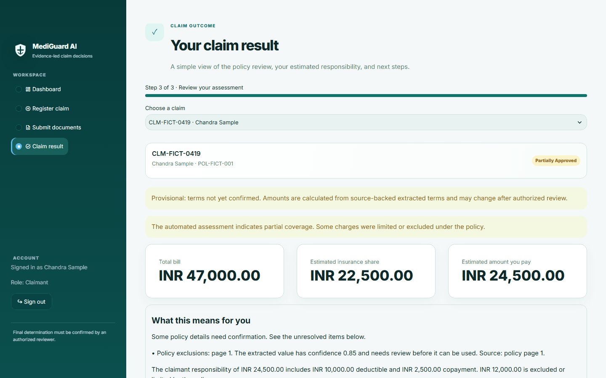
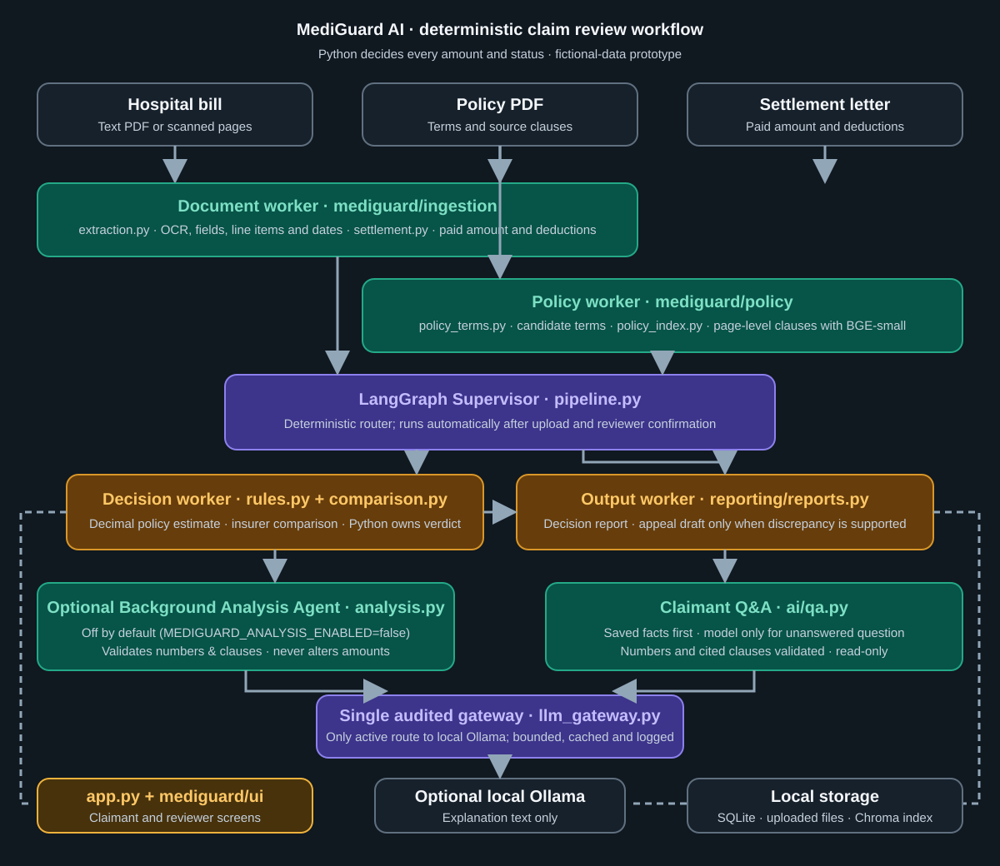

# MediGuard AI

**A fictional-data prototype for comparing health-insurance settlements with a transparent Python estimate.**

[](https://github.com/pratapasaivarun/MediGuard-AI/actions/workflows/tests.yml)
[](https://www.python.org/downloads/)
[](LICENSE)

## What it does

MediGuard AI compares an insurer's settlement with an estimate calculated from a hospital bill and policy. It flags deductions that may not agree with the policy evidence. Python rules decide every amount and status; an optional local language model only explains a completed result. This is a college prototype using fictional samples, not a system for deciding real claims.

## Screenshots

These are screenshots of the running Streamlit demo with fictional sample data. The browser viewport is 1440 × 900; no browser chrome is included.

| Settlement matches | Possible wrongful deduction | Manual review |
|---|---|---|
|  |  |  |

More screens: [sign-in](docs/images/01-login.png) · [document upload](docs/images/02-upload.png) · [appeal draft download](docs/images/04-appeal-download.png) · [reviewer confirmation](docs/images/07-reviewer-confirmation.png). To regenerate them, follow [the screenshot guide](docs/08_SCREENSHOT_CAPTURE.md).

## Key features

- Reads bill and policy PDFs, with OCR support for scanned pages.
- Extracts policy terms with page evidence and lets a reviewer correct and confirm them.
- Calculates deterministic estimates with Python rules and compares the result with parsed settlement deductions.
- Shows provisional results before reviewer confirmation and preserves review reasons for uncertain inputs.
- Creates a watermarked provisional appeal draft only when a supported discrepancy is found.
- Uses a LangGraph Supervisor with four deterministic workers and one background LLM-assisted Analysis Agent; Python decides every amount and status.
- Answers claimant questions from saved claim facts first; optional Ollama Q&A is evidence-checked and read-only.
- Keeps category suggestions disabled because the labeled category evidence scored 0/27 and adversarial category labels are absent.

## How it works



**Flow:** documents → extraction and policy terms → Python rules → settlement comparison → explanation/report → app screens.

## Quick start

Python 3.13 is the verified runtime. Tesseract is optional for scanned-page OCR. Ollama is optional and only enables local explanations. Commands below install the app and developer test dependencies.

### Windows PowerShell

```powershell
git clone https://github.com/pratapasaivarun/MediGuard-AI.git
Set-Location MediGuard-AI
py -3.13 -m venv .venv
\.venv\Scripts\python.exe -m pip install --upgrade pip
\.venv\Scripts\python.exe -m pip install -r requirements.txt -r tests/requirements-dev.txt
Copy-Item .env.example .env
$testTemp = Join-Path $env:TEMP ("mediguard-pytest-" + [guid]::NewGuid().ToString("N"))
\.venv\Scripts\python.exe -m pytest -q tests --basetemp $testTemp
\.venv\Scripts\python.exe run_demo.py
```

The demo opens at <http://127.0.0.1:8506>. Create a claimant account in the app. To test the reviewer workspace, set a temporary local admin password before starting `run_demo.py`:

```powershell
$env:MEDIGUARD_ADMIN_PASSWORD = Read-Host "Choose a local demo password"
\.venv\Scripts\python.exe run_demo.py
```

For the regular app, stop the demo with Ctrl+C and run:

```powershell
\.venv\Scripts\python.exe -m streamlit run app.py --server.port 8501
```

Open the regular app at <http://127.0.0.1:8501>.

### macOS or Linux

```bash
git clone https://github.com/pratapasaivarun/MediGuard-AI.git
cd MediGuard-AI
python3.13 -m venv .venv
. .venv/bin/activate
python -m pip install --upgrade pip
python -m pip install -r requirements.txt -r tests/requirements-dev.txt
cp .env.example .env
test_temp="$(mktemp -d)"
python -m pytest -q tests --basetemp "$test_temp"
python run_demo.py
```

The demo opens at <http://127.0.0.1:8506>. To run the regular app instead, stop the demo and use `python -m streamlit run app.py --server.port 8501`. Install Tesseract using your operating system's package manager if you need OCR for scans; set `TESSERACT_CMD` in `.env` when its executable is not on `PATH`. Ollama is optional; see [the LLM safety guide](docs/05_LLM_SAFETY.md).

## Demo cases

All case documents are fictional and labeled **FICTIONAL SAMPLE**.

| Case | Expected outcome |
|---|---|
| `a_match` | No discrepancy; no appeal draft. |
| `b_wrongful_deduction` | Possible discrepancy of INR 2,700; provisional appeal draft offered. |
| `c_manual_review` | Manual review because a scanned bill page and settlement total mismatch need attention; no appeal draft. |

## Evaluation results

Scores below are measured on 30 synthetic cases, not on real insurance claims. The hand-labeled expected results are in `samples/evaluation_cases/ground_truth.json`; reviewer-confirmed terms are separate from the PDF-extraction labels. The evaluation writes `evaluation/latest/results.json`. See [the full scorecard](docs/06_EVALUATION_RESULTS.md) and run `python.exe -m evaluation.run_all` (Windows) or `python -m evaluation.run_all` (macOS/Linux) to reproduce the offline evaluation.

| Measurement | Result |
|---|---:|
| Decision agreement with reviewer-confirmed terms | 30/30 |
| Status agreement before reviewer confirmation | 6/30; 24/30 safely routed to Manual Review |
| A visible amount, range, or specific review reason before confirmation | 30/30 |
| Policy terms extracted from source PDFs | 210/210 |
| Ollama on/off decision and amount equality | 13/13 (3 demo + 10 discrepancy cases) |
| BGE category prototype evidence gate | 0/27 valid labeled items; disabled (not enough representative labels) |

## Project structure

```text
.
├── app.py                 # Streamlit entry point
├── run_demo.py            # Isolated fictional demo launcher
├── .streamlit/            # App theme and local Streamlit defaults
├── mediguard/             # Application modules by responsibility
│   ├── ingestion/         # Bill, PDF, OCR, and settlement parsing
│   ├── policy/            # Policy term extraction and clause retrieval
│   ├── engine/            # Typed models, deterministic rules, comparison
│   ├── ai/                # Optional explanation only
│   ├── reporting/         # Decision reports and appeal drafts
│   ├── services/          # Authentication, storage, and orchestration
│   └── ui/                # Claimant and reviewer screens
├── config/                # Category mappings and trusted sample hashes
├── samples/               # Fictional bills, policies, settlements, cases
├── tests/                 # Unit, integration, browser, and golden tests
├── evaluation/            # Labeled cases, metrics, and evaluation runners
├── docs/                  # Numbered guides, results, and diagrams
├── scripts/               # Reproducible screenshot capture utility
└── .github/               # CI and contribution templates
```

## Limitations and scope

This is a prototype for synthetic data and local demonstration only. OCR quality, policy wording, and retrieval can be uncertain; reviewers must inspect source pages. It is not legal or insurance advice and is not an insurer decision system. Browser checks are opt-in and do not run in hosted CI. The live LLM was exercised for generated explanations on two resolved demo cases; other unresolved cases used the safe template fallback. Hosting and production security have not been verified.

## Documentation

- [Project overview](docs/01_OVERVIEW.md)
- [Architecture](docs/02_ARCHITECTURE.md)
- [Run the demo](docs/03_RUNNING_THE_DEMO.md)
- [Math examples](docs/04_MATH_GOLDEN_CASES.md)
- [LLM safety](docs/05_LLM_SAFETY.md)
- [Evaluation scorecard](docs/06_EVALUATION_RESULTS.md)
- [Known limitations](docs/07_LIMITATIONS.md)
- [Regenerate screenshots](docs/08_SCREENSHOT_CAPTURE.md)
- [Documentation index](docs/README.md)

## License

MIT. See [LICENSE](LICENSE).

## Contact

Maintainer: Pratapa Sai Varun. For bugs or improvement ideas, open a GitHub issue in this repository.
