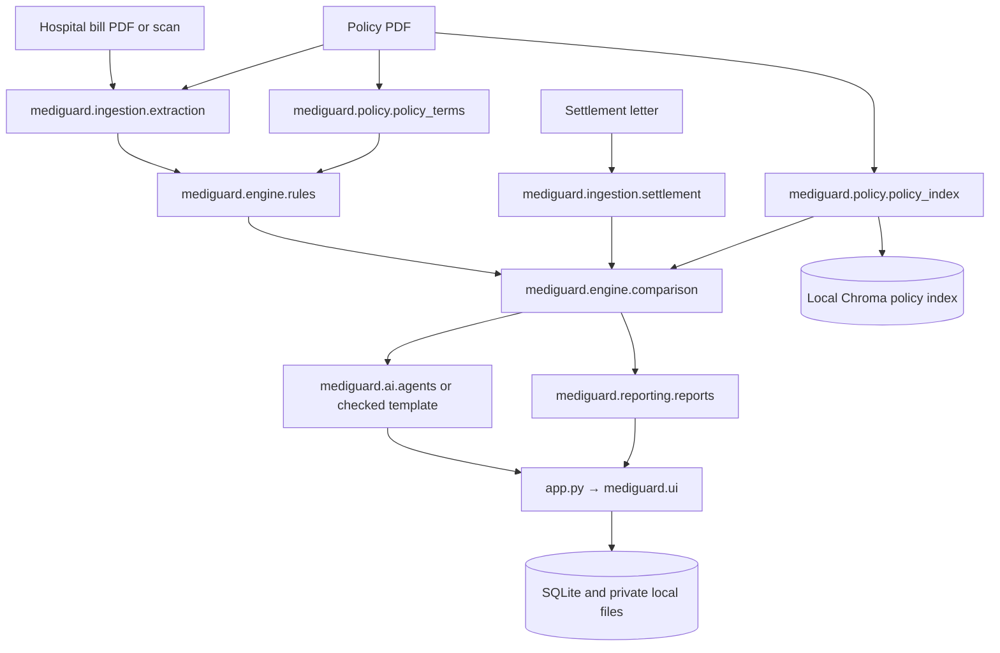

# Architecture

The main flow is bill and policy upload → document extraction → policy term review and clause indexing → deterministic rules → comparison with the parsed settlement letter → optional explanation and appeal drafts → Streamlit patient/reviewer workflow.

The rules and comparison modules use Decimal-based Python calculations. Policy retrieval uses a local Chroma vector index and the configured sentence-transformer embedding model. OCR uses local Tesseract when installed. Optional explanations use a local Ollama model. SQLite stores claim and review records; uploaded files and model/index data stay in local storage. The app does not require a remote service for its deterministic rules path.

The Streamlit entry point is [app.py](../app.py); application modules live in `mediguard/`. See [03 Running the demo](03_RUNNING_THE_DEMO.md) for commands.
