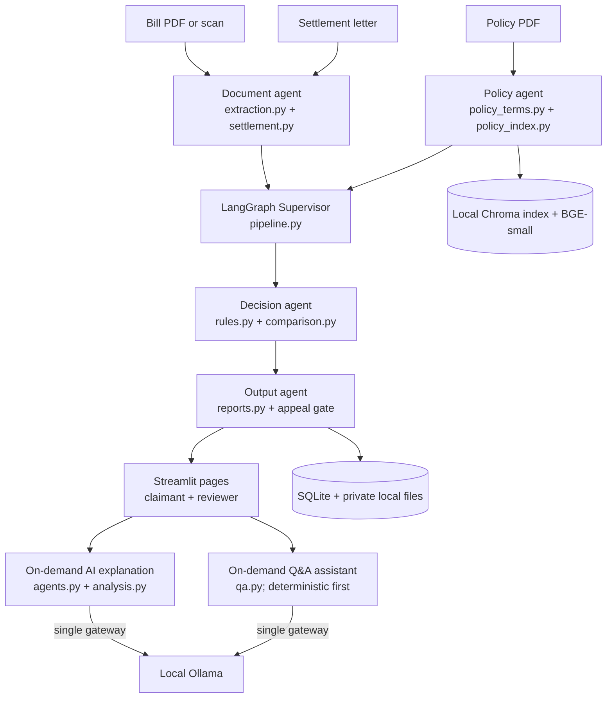

# Architecture

MediGuard AI is a LangGraph workflow of five deterministic agents (Supervisor, Document, Policy, Decision, Output) with zero automatic LLM calls by default; optional on-demand LLM explanation and Q&A; Python decides every amount. The Supervisor routes the claim stages automatically. Python rules determine every amount, status, and appeal gate; the optional model only provides checked explanation text. Optional background analysis and startup warm-up are disabled by default.

The Document agent extracts bill fields, line items, dates, payment, and settlement deductions; OCR uses local Tesseract when installed. The Policy agent extracts policy terms and indexes page-level clauses with Chroma. The Decision agent executes Decimal-based deterministic Python rules and settlement comparison. The Output agent prepares structured results and creates appeal drafts for supported discrepancies. The optional on-demand AI explanation explains the completed comparison on user request, while claimant Q&A uses deterministic saved facts first and falls back to a grounded model query only when those facts cannot answer. Category suggestions are disabled because labeled data did not clear the 90% evidence gate.

### LLM usage

All active Ollama traffic goes through `mediguard/ai/llm_gateway.py`. Python rules decide every amount, status, and appeal eligibility. By default, there are **zero automatic LLM calls**.

| Call site | Trigger | Validation | Fallback |
|---|---|---|---|
| `analysis.py` (`analyze_payload`) | Opt-in via `MEDIGUARD_ANALYSIS_ENABLED=true` (default false) | Grounded numbers, clauses, and Python comparison alignment | Deterministic template explanation |
| `llm_gateway.py` (`warmup`) | Opt-in via `MEDIGUARD_OLLAMA_WARMUP=true` (default false) | Background daemon ping (`Return only OK.`) | Logged failure, claims unaffected |
| `extraction.py` (`_llm_extract_claim_fallback`) | Opt-in via `MEDIGUARD_LLM_EXTRACTION_FALLBACK=true` (default false) | Schema check, positive Decimal amounts | Manual review reason for missing fields |
| `policy_terms.py` (`_llm_extract_policy_terms_fallback`) | Opt-in via `MEDIGUARD_LLM_EXTRACTION_FALLBACK=true` (default false) | Schema check, numeric range regex checks | Regex / keyword parsing |
| `settlement.py` (`_llm_deductions`) | Opt-in via `MEDIGUARD_LLM_EXTRACTION_FALLBACK=true` (default false) | Schema check, deduction parser | Manual review reason for missing fields |
| `agents.py` (`explain_comparison`) | User clicks "Explain with AI" on result screen | `validate_comparison_explanation` (grounded numbers & clause citations) | Rules template explanation |
| `qa.py` (`answer_question`) | Claimant submits question not answered by saved claim facts | `validate_qa_output` (grounded numbers & retrieved clauses) | `"I can't find that in this claim's documents."` |

### System limits

- **Browser tests**: Interactive Playwright browser flows are run locally for evaluation and validation; they are not run in CI environments without GUI displays.
- **LLM evaluation**: LLM safety and grounding evidence is evaluated on synthetic and adversarial benchmark cases, not real protected health information.
- **Local compute**: Runs on local CPU via Ollama (`ibm/granite4.1:8b`); no external cloud LLM dependencies are required.

The Streamlit entry point is [app.py](../app.py); see [03 Running the demo](03_RUNNING_THE_DEMO.md).
