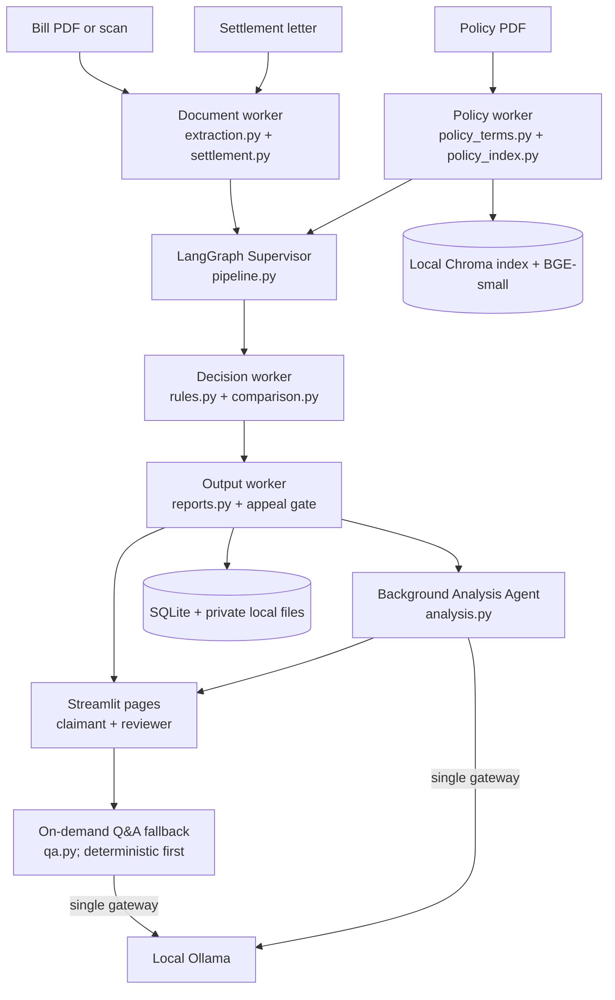

# Architecture

MediGuard is a LangGraph workflow with a deterministic Supervisor, four deterministic workers, and one LLM-assisted Analysis Agent. The Supervisor routes the claim stages automatically. Python rules determine every amount, status, and appeal gate; the optional model only provides checked explanation text.

The document worker extracts bill fields, line items, dates, payment and deductions; OCR uses local Tesseract when installed. The policy worker extracts policy terms and indexes page-level clauses. The decision worker calls the existing Decimal-based Python rules and settlement comparison. The output worker stores the result and creates reports; a possible discrepancy can produce an appeal draft. The background Analysis Agent can explain the completed comparison, while claimant Q&A uses deterministic saved facts first and makes a checked model call only when those facts cannot answer. Category suggestions are disabled because labeled data did not clear the 90% evidence gate.

All active Ollama traffic goes through `mediguard/ai/llm_gateway.py`. SQLite stores claim, review, and background-job records; uploaded files and Chroma data remain in local storage. The deterministic result path does not require a remote service. The Streamlit entry point is [app.py](../app.py); see [03 Running the demo](03_RUNNING_THE_DEMO.md).
