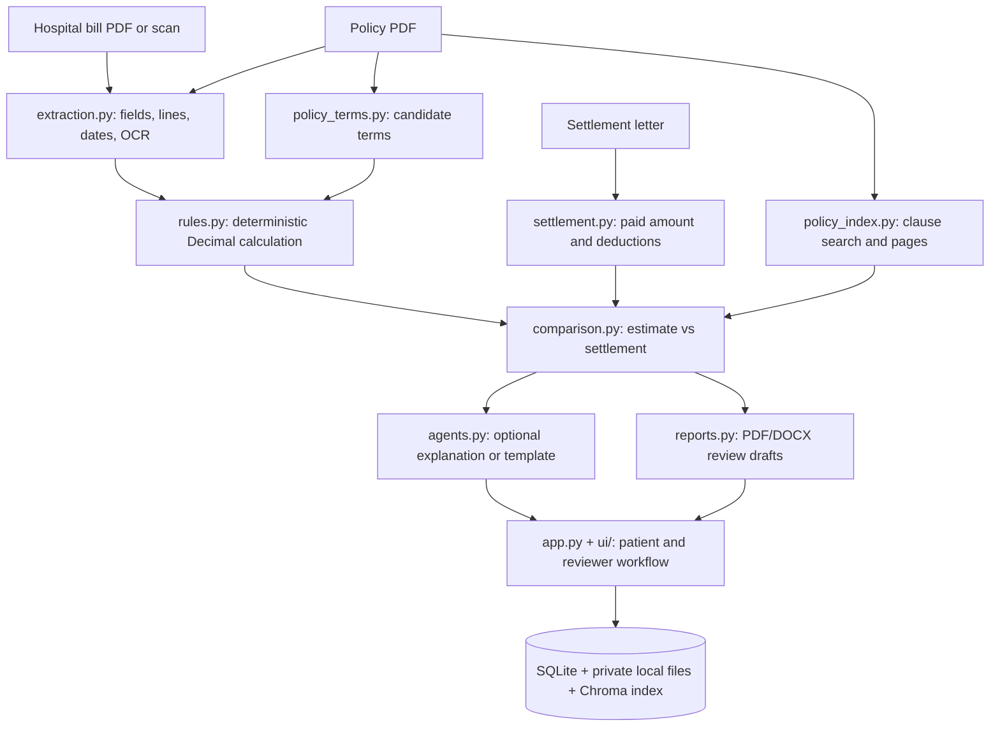

# MediGuard AI — final prototype status

**Branch:** `fix/prototype-completion`  
**Scope:** college demonstration prototype; fictional/de-identified documents only. Deployment is excluded.  
**Last verified:** 2026-10-19; `199 passed` in the full Python test suite.

## What it does

MediGuard AI reads a fictional hospital bill, policy and insurer settlement letter. It extracts dates, totals and line items, prepares policy term candidates and clause evidence, calculates a policy-based estimate with deterministic Python rules, then compares that estimate with the settlement. It can explain the result and draft an appeal, but an authorized reviewer must confirm policy terms and all final decisions. It is not an insurer decision system.

## How it is built

A more detailed architecture image is [the architecture diagram](../architecture.svg).

## Verification results

- **Math:** 17 hand-calculated rules cases and 2 comparison cases are documented in `docs/04_MATH_GOLDEN_CASES.md`. Direct tests cover deductible, co-pay, room/ICU caps, exclusions, sub-limits, annual limit, zero/boundary amounts and date windows. All passed; no expected arithmetic was changed to accommodate the implementation.
- **Automated tests:** `199 passed` with Ollama explicitly disabled; the latest complete run is recorded in `MILESTONE_LOG.md`.
- **Extraction evaluation:** `12/12` field values matched (`100%`) across three fictional bills. This is a small fixture check, not a real-world accuracy estimate.
- **Rules status agreement:** `13/24` expected labels matched (`54.17%`) on the 24 fictional scenarios after the evaluator began supplying separately recorded, source-page-backed fixture reviewer-confirmed terms and scenario context. This is a measured status agreement score, not real-world or independent-expert accuracy. Eleven expected/actual mismatches remain and are listed in the evaluation output.
- **Retrieval:** 24 labeled question-to-clause queries across 24 fictional policies (annual limit, deductible, co-payment, room limit). BGE run: precision@1 `14/24` (`58.33%`), macro precision@3 `23/72` (`31.94%`), precision@5 `24/120` (`20.00%`), recall@3 `23/24` (`95.83%`), and recall@5 `24/24` (`100%`). This is a small, synthetic-only benchmark; the weaker top-rank results, especially deductible queries, are a known retrieval issue. The former one-query score is obsolete.
- **App status check:** The separate full app harness still reports `12/24` (`50%`) because reviewer-gated cases stop before rules run. This is not a rules accuracy score; it is retained only as an end-to-end gate/status check.
- **LLM safety:** Automated tests cover fabricated numbers, down/timeout/malformed responses, and prove an explanation cannot mutate a comparison. A live three-case run with Ollama `ibm/granite4.1:8b` on/off produced identical rules status, rule payable, comparison status, expected/actual patient share, difference, decision status, and appeal availability in every case. The match explanation passed validation; the wrongful-deduction model response was rejected and used the template; manual review made no LLM call. The model produced explanations only; the Python comparison result remained unchanged.
- **Browser:** Playwright ran the three fictional cases through the real Streamlit file-upload, reviewer policy-confirmation, rules and settlement-comparison screens. Match: no discrepancy, ₹0 difference, no appeal. Wrongful deduction: possible discrepancy, ₹2,700 difference, appeal available. Manual review: scanned bill page and mismatched totals, no appeal. The five upload-error paths were checked: empty, wrong type and oversized files were rejected; a malformed PDF was flagged during extraction; missing settlement showed a clear upload prompt. Historical screenshots were saved outside the repository and recorded in the milestone log. The first B run used a stale local Chroma index and safely stopped for review; an isolated clean index retrieved the policy clause and produced the expected possible discrepancy.

## Limits and next actions

The sample is fictional and small. Policy interpretation, OCR, retrieval relevance and generated draft quality are not validated by independent insurance experts. The weak precision scores and eleven rules-status mismatches remain. A stale local Chroma store can omit indexed clauses until it is rebuilt. Docker/hosting was excluded as requested. Do not use real patient documents or treat estimates as final decisions.

## Run it

1. From the repository root, create `.env` from `.env.example` and set a strong `MEDIGUARD_ADMIN_PASSWORD` only if an administrator login is needed.
2. Activate `.venv`, then run `python -m streamlit run app.py` and open `http://127.0.0.1:8501`. For isolated synthetic demo storage, run `python run_demo.py` at port `8506`.
3. Use only documents under `samples/demo_cases/`. A reviewer must confirm policy values and source pages before financial results are shown.
4. Verify code with `python -m pytest -q`. See `docs/03_RUNNING_THE_DEMO.md` for fixture paths and expected outcomes.
