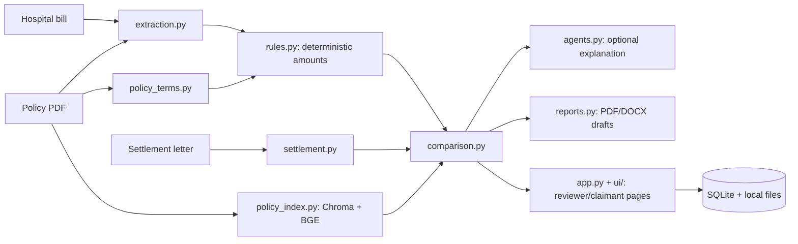

> **Current status update (2026-10-19, branch `fix/prototype-completion`).** Phases 2–4 rebuilt hand-calculated tests and fictional evaluation labels. Current evidence: 198 tests pass; extraction is 12/12 fields on 3 fictional bills; end-to-end app status agrees with 12/24 synthetic scenario labels, with standalone core-rule status still unscored because the evaluation harness does not confirm reviewer policy terms. Browser work has verified account creation and uploads, but not the complete three-case plus error-state Playwright matrix. The rest of this file is the earlier baseline audit and is superseded by `docs/archive/ARCHIVED_PROJECT_REPORT_2026-10-19.md` after the remaining phases.

# MediGuard AI — End-to-End Project Status

**Audit date:** 2026-10-19
**Repository:** `<REPO_ROOT>`
**Branch:** `fix/prototype-completion`
**Audited commit:** `103b19c8c2ddbbc8772bca99006b6042d12978c4`
**Scope:** read-only code/history review plus install, test, compile, evaluation, and Streamlit smoke checks. This report is not a clinical, legal, privacy, or penetration assessment. No application code was changed during this audit.

## 1. Purpose

MediGuard AI is an academic decision-support prototype. A claimant or reviewer supplies a hospital bill, insurance policy, and insurer settlement letter. The software extracts information, calculates what the policy rules appear to support, compares that estimate with the settlement, points to policy evidence where it can find it, and can draft a letter asking for a review.

It is intended for a student demonstration and human reviewers, not for making real insurance decisions. The README and implementation plan say to use fictional data only. An authorized person must review the evidence and make the final decision. The code, comments, tests, and commit history consistently aim to keep financial calculations in ordinary Python rules and use the optional language model only for extraction help or explanation.

## 2. Architecture

### Technology and storage

- Python 3.13.1; Streamlit 1.62.0 for the browser interface.
- PyMuPDF reads PDF text. Tesseract OCR, called through `pytesseract`, handles pages without usable text.
- `policy_terms.py` extracts candidate policy limits and terms. `policy_index.py` uses ChromaDB and the BGE-small sentence-transformer model to search policy passages and page references.
- `rules.py` uses decimal amounts for deterministic claim calculations. `settlement.py` parses insurer letters. `comparison.py` compares settlement deductions with the calculated result.
- Ollama at `http://localhost:11434`, model `ibm/granite4.1:8b`, is optional. The application has template explanations when the model is unavailable.
- SQLite stores accounts, claims, uploaded-document metadata, review decisions, and saved comparison results. Uploaded documents and Chroma data are local files. Docker is configured to keep these under `/app/data`.
- `reports.py` produces PDF and DOCX review drafts. No email provider or external claims service is integrated.

### Folder map

```text
app.py                  Streamlit entry point, authentication, persistence, orchestration
ui/                     Sign-in, claimant/reviewer pages, shared presentation helpers
models.py               Shared typed data structures
extraction.py           Bill/policy PDF reading, field and line extraction, OCR
policy_terms.py         Candidate policy terms and reviewer-source handling
policy_index.py         Policy text chunks, Chroma indexing and retrieval
rules.py                Deterministic coverage calculations
settlement.py           Settlement letter parsing and validation
comparison.py           Settlement-to-rule comparison
agents.py               Optional Ollama prompts, evidence-bound explanations
reports.py              Appeal/hospital-note text, PDF and DOCX drafts
config/                 Categories and trusted synthetic-fixture hashes
fixtures/, samples/assets/  Fictional bills, policies, settlements and scenarios
tests/                  Unit, security, parser, comparison and workflow regressions
evaluation/             Synthetic evaluation scripts, annotations and old outputs
docs/                   Decisions, changelog, demo guide, audits and implementation plan
.github/workflows/      Pytest workflow on push and pull request
Dockerfile              Container recipe; has not been built in this environment
```

### Data flow



### How to run and deploy

The documented local command is `python -m streamlit run app.py` (normally at `http://127.0.0.1:8501`). `run_demo.py` starts the isolated synthetic demo on port 8506. Docker instructions are in the README and Dockerfile, but a Docker build could not be run here because Docker is not installed. The model and embedding weights are not bundled in the image; first retrieval may need a local cache or network access.

## 3. Current state: checks actually run

Environment: existing `.venv`, Python 3.13.1, Streamlit 1.62.0. Tesseract 5.4.0 is installed at the configured Windows path. `ollama list` succeeded and showed `ibm/granite4.1:8b` (5.3 GB). Tests were run with `OLLAMA_HOST=http://127.0.0.1:1` so they could not call the model.

| Check | Result |
|---|---|
| `python -m pip install --no-index --no-input -r requirements.txt` | Exit 0. Every pinned requirement was already installed. |
| `python -m pip check` | `No broken requirements found.` |
| `python -m pytest -q --basetemp <USER_HOME>\mediguard_status_audit_pytest` | `166 passed in 104.66s (0:01:44)`. No failures or skips were reported. |
| `python -m compileall -q ...` for app, business modules, UI and tests | Exit 0; `COMPILEALL_EXIT=0`. |
| Streamlit launch at port 8517 with isolated storage | Started. `GET /_stcore/health` returned `HTTP=200`, body `ok`. Server was stopped after the check. This was a health smoke test, not a browser claim workflow. |
| `evaluation/scripts/run_system_evaluation.py --rules-only --output ...` | Completed on 24 synthetic cases and loaded the configured backend (`BAAI/bge-small-en-v1.5`). It reported rule and decision accuracy as “Not Evaluated — Ground Truth/Data Required”; retrieval annotations count is 0. No trustworthy accuracy score was produced. |
| `evaluation/scripts/run_evaluation.py --repeats 1` | Failed because the legacy ground-truth manifest is absent; exact traceback below. |
| `docker build -t mediguard-status-audit .` | Could not start because Docker is not installed; exact error below. |

Legacy extraction evaluation error:

```text
Traceback (most recent call last):
  File "<REPO_ROOT>\evaluation\run_evaluation.py", line 309, in <module>
    raise SystemExit(main())
                     ~~~~^^
  File "<REPO_ROOT>\evaluation\run_evaluation.py", line 258, in main
    extraction = evaluate_extraction(args.repeats, annotations)
  File "<REPO_ROOT>\evaluation\run_evaluation.py", line 65, in evaluate_extraction
    manifest = json.loads(manifest_path.read_text(encoding="utf-8"))
                          ~~~~~~~~~~~~~~~~~~~~~~~^^^^^^^^^^^^^^^^^^
  File "C:\Program Files\Python313\Lib\pathlib\_local.py", line 546, in read_text
    return PathBase.read_text(self, encoding, errors, newline)
           ~~~~~~~~~~~~~~~~~~^^^^^^^^^^^^^^^^^^^^^^^^^^^^^^^^^
  File "C:\Program Files\Python313\Lib\pathlib\_abc.py", line 632, in read_text
    with self.open(mode='r', encoding=encoding, errors=errors, newline=newline) as f:
         ~~~~~~~~~^^^^^^^^^^^^^^^^^^^^^^^^^^^^^^^^^^^^^^^^^^^^^^^^^^^^^^^^^^^^^
  File "C:\Program Files\Python313\Lib\pathlib\_local.py", line 537, in open
    return io.open(self, mode, buffering, encoding, newline)
           ~~~~~~~^^^^^^^^^^^^^^^^^^^^^^^^^^^^^^^^^^^^^^^^^^^
FileNotFoundError: [Errno 2] No such file or directory: '<REPO_ROOT>\fixtures\phase4\ground_truth.json'
```

Docker build error:

```text
docker:
Line |
   2 |  docker build -t mediguard-status-audit .
     |  ~~~~~~
     | The term 'docker' is not recognized as a name of a cmdlet, function, script file, or executable program.
Check the spelling of the name, or if a path was included, verify that the path is correct and try again.
```

There is no `pyproject.toml`, `setup.py`, or `Makefile`; this is an app repository run directly by Streamlit, not a Python package with a separate build command.

## 4. Implemented versus missing

“Done” below means implemented and covered by the available synthetic tests, not proven accurate on real insurer documents.

| Feature/module | Status | Evidence and limit |
|---|---|---|
| Shared data models and deterministic rules | Done | `models.py` and `rules.py`; tests cover deductible, co-pay, room/ICU caps, exclusions, dates and review conditions. Real claim outcomes are not validated. |
| Bill PDF/text extraction and table handling | Done | Regression tests cover table columns, totals, amounts, dates, IDs, repeated headers, categories and review flags. Real-world layouts remain unmeasured. |
| Scanned-page OCR | Partial | Tesseract is installed and per-page OCR is implemented. Tests include OCR stubs and unavailable-OCR review behavior; this audit did not run a full scanned upload through the browser. |
| Policy-term extraction and source confirmation | Done | Candidate terms, review flags, source pages and page-range checks are tested. It still needs a human to confirm values. |
| Policy clause indexing and retrieval | Partial | Fresh rules evaluation initialized BGE successfully, but there are no retrieval annotations or measured precision/recall. Retrieval quality is unproven. |
| Settlement parsing | Done | Six synthetic layouts, image-only manual-review behavior, missing-paid-amount handling and a 200-input malformed-text test are covered. This is not validation against a representative insurer corpus. |
| Settlement comparison and date-window checks | Done | App-path and comparison tests cover deductible, co-pay, date-window, possible discrepancy and manual review. The current audit did not repeat all UI paths manually. |
| Optional explanations and PDF/DOCX drafts | Partial | Template fallback and draft generation are tested. Live Ollama explanation and all download buttons were not exercised in this audit. |
| Claimant/reviewer/admin Streamlit workflows | Partial | Authentication, role checks, review gates and pages exist; app health is live. No fresh Playwright pass through login, uploads, comparison and download was run. |
| Authentication and account controls | Partial | Password hashing, throttling, roles and invitation/reset flows are implemented and tested. MFA and email delivery are not implemented. |
| Upload validation and storage | Partial | File type/signature, size, empty input and traversal checks have regression tests. SQLite and uploaded files are local and not encrypted at rest by the application. |
| Three fictional Phase 4 cases | Done in tests | Match, possible discrepancy and manual-review cases are exercised by app-path tests; browser screenshots are earlier evidence, not a fresh run in this audit. |
| CI | Partial | A GitHub Actions pytest workflow exists. The current GitHub Actions result was not checked. |
| Docker deployment | Partial | Dockerfile and pinned direct requirements exist, but image build and container startup are unverified. |
| Legacy extraction evaluation | Broken | Runner expects missing `evaluation/ground_truth.json`. |
| Human accuracy/retrieval evaluation | Not started | No annotated retrieval queries or ground-truth extraction set is present. Current rules-only evaluator explicitly returns “Not Evaluated”. |
| Production privacy/deployment | Not started | Project explicitly says synthetic data only; encryption, production hosting controls, operational retention and security review are not established. |
| Automated data deletion/claim deletion | Partial / not started | Admin can delete documents and manually purge expired document rows; there is no claim-level cascade/delete workflow or automatic purge. |

## 5. Problems and risks, ranked

No confirmed critical defect was found by this audit. These are the concrete issues and unresolved risks supported by the code or run results; this is not a guarantee that no other bugs exist.

| Severity | Finding | Cause / evidence |
|---|---|---|
| **High — deployment blocker** | Do not use this prototype with real patient records or make real claim decisions. | README and plan restrict it to fictional data. Local SQLite and uploads are not application-encrypted at rest; real-world OCR, retrieval and rule accuracy are not established. |
| **High — evaluation blocker** | There is no current end-to-end accuracy score. | `evaluation/ground_truth.json` is missing and retrieval annotations contain zero labeled queries. The legacy evaluator crashes and the fresh rules-only evaluator reports “Not Evaluated”. Old saved evaluation numbers must not be presented as current validation. |
| **Medium** | Generated invitation/reset links may point to the wrong local port. | `APP_BASE_URL` defaults to port 8505 in `app.py` and `.env.example`; README’s default Streamlit command uses 8501, while `run_demo.py` uses 8506. Link flows need a matching configured URL. |
| **Medium** | The project audit documents are stale. | `docs/archive/PROJECT_AUDIT.md` says it reviewed branch `finish-mini-prototype` and 116 tests; `docs/archive/XSS_AUDIT.md` describes the old monolithic `app.py` markup layout. Current branch has 166 tests and presentation helpers under `ui/`. |
| **Medium** | Full browser and deployment behavior remains unverified. | This audit checked only Streamlit’s health endpoint. Docker is unavailable here; the Playwright error-state matrix and a live end-to-end browser run were not repeated. |
| **Medium** | Error handling can show raw exception text in the interface. | Several page handlers call `st.error(str(exc))` in `ui/claim_pages.py`. This is friendlier than a traceback but may reveal local paths or implementation details for some failures; user-facing error redaction is not consistently demonstrated. |
| **Medium** | No dependency vulnerability scan result is available. | Direct dependencies are pinned and `pip check` passes, but `pip-audit` or an equivalent security advisory scan was not run. Passing dependency resolution does not mean packages were security-scanned. |
| **Low** | Local configuration is machine-specific. | Tesseract example/default points to a Windows install path; `policy_index.py` defaults `HF_HOME` under `.venv/hf-cache`. Docker overrides Tesseract but not the model cache location. Fresh hosts need correct paths/cache and may need network access. |
| **Low** | Repository working tree has untracked generated artifacts. | Existing screenshots, evaluation outputs, Chroma files and pytest temp files appear as untracked. They are not in the branch, but should be excluded from any manual archive or cleaned after preserving needed evidence. `.env`, `.venv/` and `data/` are ignored. |
| **Low** | The main app module carries many responsibilities. | `app.py` handles authentication, database access, storage and orchestration as well as routing. This makes future changes harder to review and isolate, though the current tests pass. |

Security notes: `.env` exists locally but is ignored and was not read. Git reports no tracked `.env`, database, or key file. Do not include the local `.env`, `data/`, `.venv/`, or temporary Chroma/screenshots in a distribution. The branch history retains deleted insurer-document PDFs; the owner confirmed those files are fictional/de-identified. History was not rewritten. No hard-coded published admin password was found in the tracked configuration inspected; admin provisioning requires an environment password.

## 6. Recent history and where work stalled

The current branch is `fix/prototype-completion` at `103b19c`. `f981ecf` is an ancestor, and `origin/master` is also an ancestor; this branch has 79 commits beyond the remote `master` base. The current branch tracks its remote and has no new commits pending push. The local `master` reference is separately two commits ahead of `origin/master`; this audit did not merge branches.

Recent work completed the prototype pipeline: single deterministic calculation path, extraction/table/date fixes, settlement parsing and claim binding, deductible handling, clause filtering, date-window comparison, appeal generation, and synthetic Phase 4 examples. The newest commits add source-page tests, image-only settlement review, exclusion-list parsing, malformed-input coverage, traversal/upload checks, retention tests, repeated-header/OCR tests, and documentation updates. The latest run passes all 166 tests.

The project appears to have stalled at “synthetic prototype complete” rather than release readiness. Evidence: evaluation fixtures are missing; the docs still describe an earlier branch/count; CI has not been checked from GitHub; Docker has not been built; and a complete browser error-state pass has not been recorded. Older branches and prior ZIPs also caused confusion about which code was current. The pushed branch is the most recent source, but users should verify the branch/commit before packaging.

## 7. Completion estimate and remaining work

**Estimate: about 75% complete for the academic prototype; not production-ready.** The bill-to-policy-to-rules-to-settlement comparison pipeline and three synthetic cases are implemented and pass tests. The remaining quarter is mainly trustworthy evaluation evidence, full browser verification, deployment checks and clearer operational/privacy controls. This percentage is a planning estimate, not a measured metric.

| Remaining task | Size | Why it remains |
|---|---|---|
| Restore or replace the missing extraction ground truth and add reviewed retrieval labels | Large | The current legacy evaluation fails and there is no measurable extraction/retrieval accuracy. Labels need human verification. |
| Run the three demo cases in Playwright and capture all requested error states | Medium/Large | The app-path tests pass, but browser upload, navigation, error messages and downloads have not been freshly verified end to end. |
| Build and run the Docker image on a host with Docker | Medium | Docker CLI/engine is absent in this audit environment. Container behavior and memory headroom remain unverified. |
| Update stale audit/security documents and resolve the `APP_BASE_URL` port mismatch | Small | Current docs and local link defaults do not consistently match current code/run ports. |
| Run dependency advisory scan and review production storage/retention settings | Medium | `pip check` checks compatibility, not known vulnerabilities. Real-data use is out of scope until privacy controls are designed and reviewed. |
| Verify current GitHub Actions run and maintain a clean distributable archive | Small | Workflow exists, but this audit did not inspect the GitHub run; local untracked artifacts remain. |

## 8. Fastest completion plan

Each check below is designed to be independently verifiable in under five minutes once prerequisites exist.

1. **Reconfirm the baseline.** Check out `fix/prototype-completion`; run `git status --short --branch`, then `python -m pytest -q`. **Done when:** branch hash matches the reported remote commit and all 166+ tests pass.
2. **Fix configuration and documentation drift.** Align `APP_BASE_URL` with the actual selected Streamlit port and update the stale audit docs/test count. **Done when:** a generated invitation link opens the running app’s configured URL and a repository search shows the current branch/count in the audit docs.
3. **Restore measurable evaluation.** Provide a reviewed fixture manifest and retrieval labels, then run the rules-only and extraction evaluations. **Done when:** both commands exit 0 and print scored denominators/results, with reviewers able to spot-check one case in under five minutes.
4. **Verify the browser workflow.** With Ollama off, use Playwright to run each synthetic case and the upload/error cases. **Done when:** screenshots show expected status/amounts; appeal downloads appear only for the supported possible discrepancy; all other cases show manual review or a friendly error.
5. **Verify deployment.** Build and launch Docker with persistent private storage and Tesseract; test the health route and one synthetic scanned page. **Done when:** `docker build` succeeds, `docker run` returns healthy, and the container reports the actual BGE backend or a clear fallback.
6. **Close the release checklist.** Check the GitHub Actions run, run a dependency advisory scan, refresh the archive without `.env`, databases, caches or test artifacts, and document storage/retention limits. **Done when:** CI is green, scan findings are triaged, and an archive listing contains only the intended source, docs, tests and fictional fixtures.

## Audit evidence and limits

The included implementation plan is `docs/archive/IMPLEMENTATION_PLAN.pdf`; current workflow and setup are documented in `README.md` and `docs/03_RUNNING_THE_DEMO.md`. This audit executed the test suite, dependency checks, compilation, health route, and evaluation commands listed above. It did not inspect the contents of local `.env` or `data/`, test with real patient or insurer documents, perform penetration testing, test a remote deployment, or prove that the software is free of defects.

